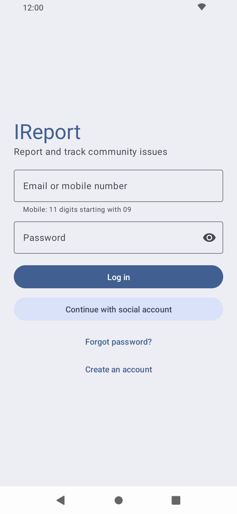
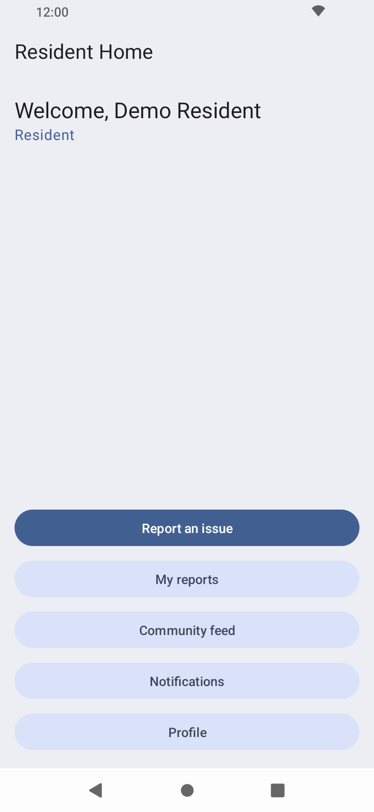
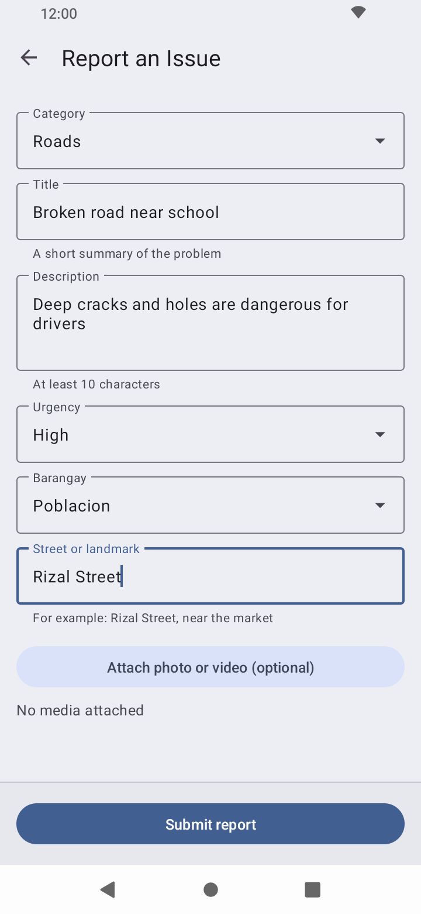
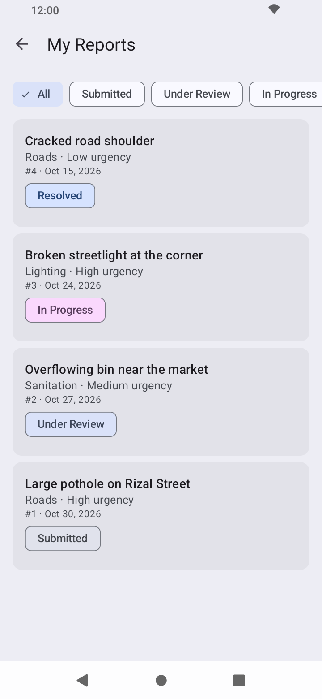
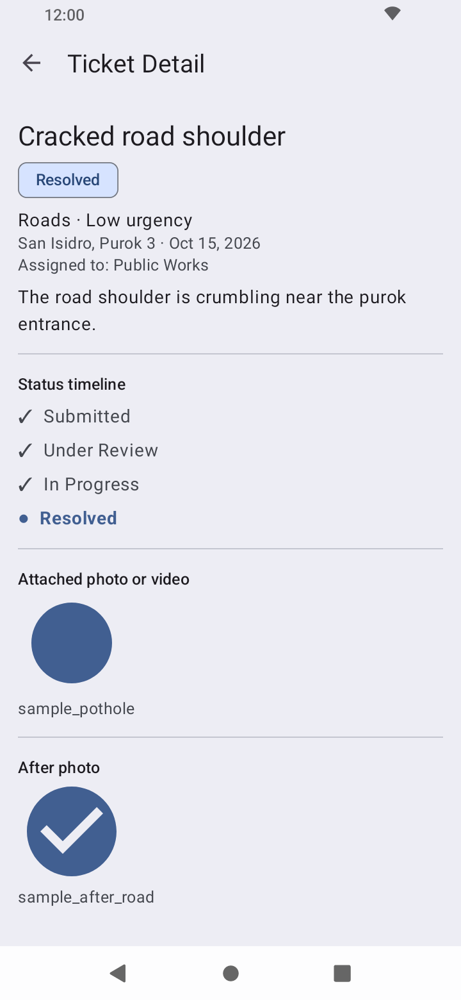
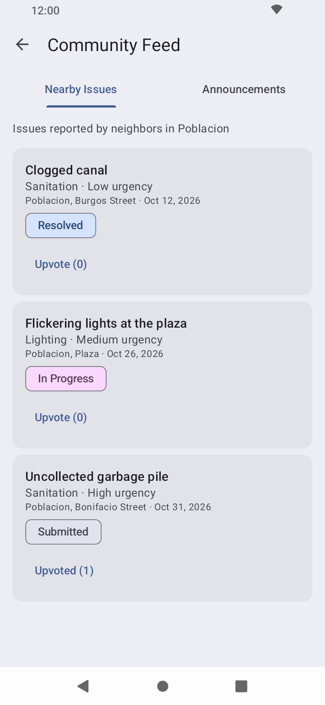
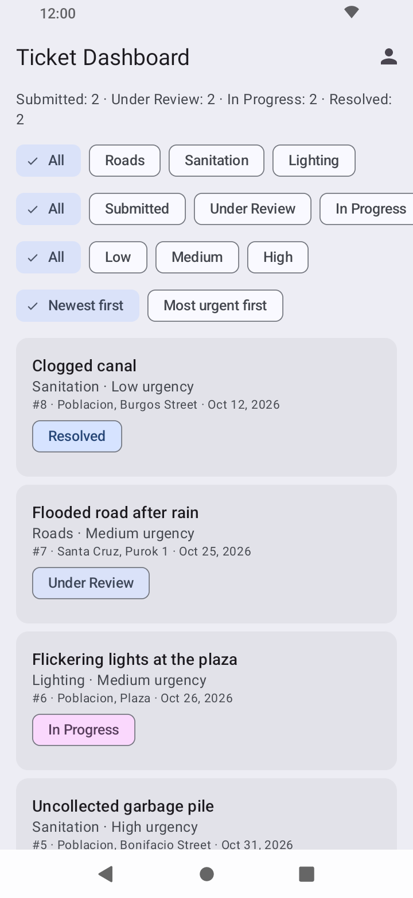
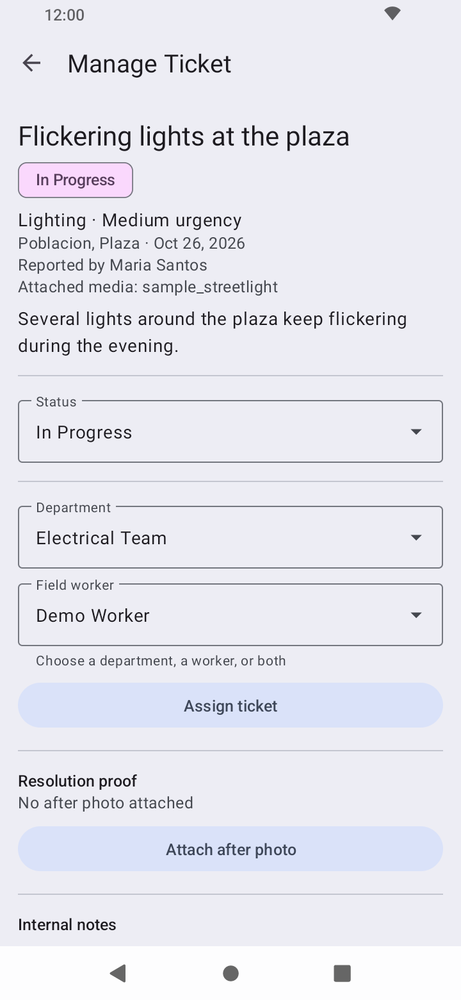
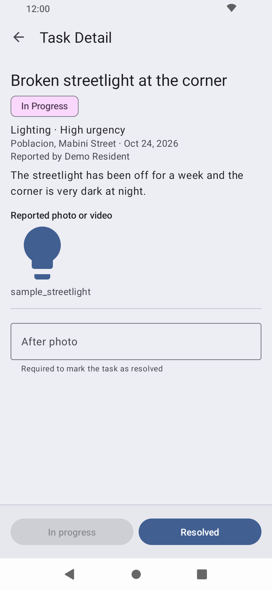

# IReport

An Android app for reporting community issues. Residents report damaged roads, overflowing trash bins and broken streetlights, admins review and assign the reports, and field workers fix them and upload an "After" photo. The resident sees every status update. The whole app works offline with no backend.

**Core flow:** Resident reports an issue → Admin reviews and assigns it → Field Worker fixes it and uploads an "After" photo → Resident sees the status update

## About

IReport is a practice project built in preparation for the Tagisan ng Talino 2026 - 2027 Code Fest hackathon. It is a simulation: everything is stored on the device in SQLite, and there is no server, email, SMS or real push notification.

| | |
|---|---|
| Team Name | ERRAnds |
| Team Members | [Vrixzandro Eliponga](https://github.com/mowtiie), [Michael Tagle](https://github.com/ImmunoCapacity), [Christine Jane Lapuz](https://github.com/chrstnjn) |

## Features

**Registration and authentication**
- Sign up as a Resident, Admin or Worker using the role tabs, with a name, mobile number, email and password. The mobile number is 11 digits starting with `09`, the email must be valid and the password is at least 6 characters
- Log in with an email or mobile number and a password. The stored account decides which home screen opens
- Reset a forgotten password, and try a simulated social sign-in that logs in the demo resident

**Resident**
- Report an issue with a category (Roads, Sanitation or Lighting), title, description, urgency, barangay and street, and an optional photo or video
- My Reports lists your tickets newest first, with a status filter. Ticket Detail shows the status timeline and the "After" photo once the issue is resolved
- Community Feed shows nearby issues from other residents in your barangay, with an upvote toggle, and the barangay announcements
- Notifications list every status change of your tickets, with unread ones in bold
- Profile lets you edit your name, mobile and email, turn notification messages on or off, and log out

**Admin**
- Ticket Dashboard lists all tickets with filters for category, status and urgency, sorting by newest or urgency, and a count per status
- Ticket Detail lets you change the status, assign the ticket to a department, a field worker or both, attach "After" proof and add internal notes
- Assigning a Submitted ticket moves it to Under Review

**Field Worker**
- Assigned Tasks lists the tickets assigned to you, unresolved ones first, with a status filter
- Task Detail lets you set a task to In Progress or Resolved. Resolved requires an "After" photo

**Notifications**
- Every status change adds a notification for the ticket owner. The owner also gets a "Ticket #id is now ..." message when they are the logged-in user and notifications are on
- Notifications are in-app only, with no Android notifications or channels

## Tech specs

| | |
|---|---|
| Language | Java 11 |
| UI | XML layouts, Material Design 3 (Material Components 1.14), view binding |
| Min / target SDK | 24 (Android 7.0) / 36 |
| Build | Android Gradle Plugin 9.2.1 |
| Storage | Local SQLite for users, tickets, notes, upvotes, announcements and notifications |
| Media | System Photo Picker (`PickVisualMedia`), no permissions needed. Picked files are copied into the app's own storage |
| Theme | Material Theme Builder palette |
| Navigation | One Activity per screen, no fragments |
| Libraries | AndroidX AppCompat, Activity, ConstraintLayout and Material Components only |

## Requirements

- Android Studio (a recent version that supports AGP 9.x) and JDK 11 or newer
- An Android emulator or device running Android 7.0 (API 24) or higher

## Getting started

```bash
git clone https://github.com/mowtiie/IReport.git
cd IReport
./gradlew assembleDebug
```

Then open the project in Android Studio and press **Run** on an emulator. The debug APK is created at `app/build/outputs/apk/debug/`.

## Demo accounts

Demo data is seeded when the database is first created, so you can log in and look around without adding anything. Every account uses the password `demo1234`.

| Email | Role | Data |
|---|---|---|
| `resident@demo.com` | Resident | 4 tickets across all four statuses and 3 notifications |
| `admin@demo.com` | Admin | The full ticket dashboard, with 8 tickets and a note |
| `worker@demo.com` | Field Worker | 5 assigned tasks |
| `neighbor@demo.com` | Resident | Owns the other residents' tickets shown in the Community Feed |

The seed also adds 3 announcements. You can also create your own account on the sign up screen.

## Notes

- Data is saved in local SQLite and persists across restarts.
- The database is recreated when its version changes, so upgrading across a schema change clears the saved data.
- Accounts are simulated. Passwords are stored as plain text in the local database, so do not use a real password.
- Nearby issues are the other residents' tickets in your home barangay, which is the barangay where most of your own tickets are.
- Photos are shrunk to 1280 px before they are saved. Videos are copied as they are.

## Screenshots

<div align="center">
	<div>
         
         
         
         
         
         
         
         
         
	</div>
</div>

## Release build

```bash
./gradlew assembleRelease
```

Release builds are minified and shrunk. To sign them, copy `keystore.properties.example` to `keystore.properties` in the project root and fill in your keystore path, alias and passwords. Without that file `assembleRelease` still builds, but the APK is unsigned (`app-release-unsigned.apk`). The signed APK is created at `app/build/outputs/apk/release/`.

Keystore files and `keystore.properties` are git-ignored and must never be committed.

## Verification

APK releases on GitHub are signed using my key. They can
be verified using
[apksigner](https://developer.android.com/studio/command-line/apksigner.html#options-verify):

```
apksigner verify --print-certs --verbose ireport.apk
```

The output should look like:

```
Verifies
Verified using v1 scheme (JAR signing): false
Verified using v2 scheme (APK Signature Scheme v2): true
Verified using v3 scheme (APK Signature Scheme v3): false
Verified using v3.1 scheme (APK Signature Scheme v3.1): false
Verified using v3.2 scheme (APK Signature Scheme v3.2): false
Verified using v4 scheme (APK Signature Scheme v4): false
```

The certificate fingerprints should correspond to the ones listed below:

```
Owner: CN=Mowtiie
Issuer: CN=Mowtiie
Serial number: 8a256fdcdde50069
Valid from: Wed Jun 10 22:57:23 PST 2026 until: Sun Oct 26 22:57:23 PST 2053
Certificate fingerprints:
         SHA1: 56:4E:2C:DB:E4:06:C9:EC:15:E6:BC:D9:0A:88:38:72:8B:FB:13:20
         SHA256: 8B:67:51:F3:C3:31:85:63:5F:98:95:30:B6:C0:73:A1:39:7B:3D:41:2B:EF:AE:69:06:A2:EB:58:45:D2:DE:63
```

**Warning:** Only install IReport APKs signed with the key above. Verifying the signature confirms you're running a genuine, unmodified build.

### PGP Signing

As an additional layer on top of the Android signature above, each release is also signed with my PGP key. While `apksigner` confirms the APK itself is intact, a PGP signature confirms that *I* am the one who published this specific file to GitHub — an independent check that doesn't rely on GitHub's account security alone.

**Public key fingerprint:**
```
9EA2 8F46 7802 5092 7643 1B69 42B5 FA42 AA63 90E1
```

Download and import the key from my website, or directly from this repo:

```
curl -O https://mowtiie.cc/PGP_PUBLIC_KEY.asc
gpg --import PGP_PUBLIC_KEY.asc
```

After importing, confirm the fingerprint printed by GPG matches the one listed above — that match is what actually establishes trust, not the import step itself. Fetching the key over HTTPS from a domain you already trust is arguably a stronger anchor than a keyserver, since keyservers accept uploads from anyone and don't vouch for identity.

Each release includes a detached `.asc` signature alongside the APK. Verify a downloaded release with:

```
gpg --verify ireport-X.X.apk.asc ireport-X.X.apk
```

A valid signature looks like:

```
Good signature from "Mowtiie <mowtiie.dev@gmail.com>"
```

**Note:** PGP signing is a supplementary trust measure, not a substitute for the `apksigner` check above — verify both if you want the highest confidence that a release is genuine and unmodified.

## License

IReport is released under the [MIT License](LICENSE).
